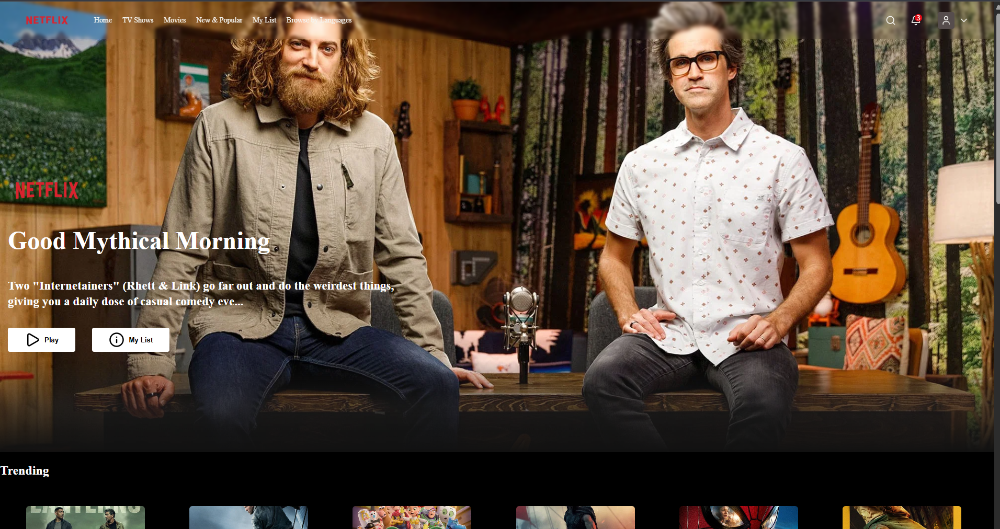

# 🎬 StreamHub - Movie & TV Show Discovery App

A modern entertainment discovery web application built with **React JSX** and **Vite**.
This project replicates the structure of a streaming platform interface while focusing on reusable React components, responsive design, CSS styling, and component-based organization.

## 🚀 Technologies Used

* React.js
* JSX
* Vite
* CSS / CSS Modules
* React Icons
* JavaScript
* ESLint

## ✨ Features

* StreamHub interface design
* Fully responsive layout
* Reusable React components
* Hero/Banner media section
* Horizontal movie display rows
* Interactive movie and show cards
* Featured image slideshow
* Dynamic navigation header
* Simulated demo sign-in, account page, and sign-out dashboard
* Comprehensive platform-style footer
* Social media connectivity integrations
* Clean, component-based folder structure

## 📁 Project Structure

```text
STREAMHUB/
│
├── public/
├── Resources/
│
├── src/
│   ├── assets/
│   │
│   ├── Components/
│   │   ├── Banner/
│   │   ├── DisplayRow/
│   │   ├── Footer/
│   │   ├── Header/
│   │   ├── MovieCard/
│   │   └── SlideShow/
│   │
│   ├── Data/
│   ├── Utility/
│   │
│   ├── App.jsx
│   └── main.jsx
│
├── .env
├── .env.example
├── .gitignore
├── eslint.config.js
├── index.html
├── package.json
├── package-lock.json
├── vite.config.js
└── README.md
```

## 🧩 Main Components

### Header
Contains the main navigation menu and StreamHub branding layout.

### Demo Account Flow
Use the profile menu to access the mock sign-in form. The demo accepts any valid email formatting and a non-empty password. For safety and compliance, user data is only simulated in the browser's local storage. This is exclusively a frontend demonstration and does not communicate with or process data against an actual backend server. Authenticated demo users can access the `/account` route and trigger the sign-out action at any time.

### Banner
Displays the primary featured title and hero display showcase.

### DisplayRow
Arranges collections of entertainment media content into smooth, horizontal scrolling rows.

### MovieCard
A flexible component architecture optimized for displaying standalone poster assets and contextual title information.

### SlideShow
Manages the carousel logic and transitional mechanics for the application's top featured banners.

### Footer
Houses contextual navigation nodes, directory links, and social media layout anchors.

## ⚙️ Installation

Clone the repository:

```bash
git clone <your-repository-url>
```

Navigate into the root project directory:

```bash
cd STREAMHUB
```

Install the project dependencies:

```bash
npm install
```

Start the local development server:

```bash
npm run dev
```

Open the execution URL provided by Vite inside your browser.

## 🔐 Environment Variables

Create a custom `.env` file in the project root directory and apply your personal TMDB API parameters.

Example:

```env
VITE_API_KEY=your_api_key
```

## 🛠️ Build for Production

To compile an optimized production build run:

```bash
npm run build
```

The production-ready client assets will be compiled directly into the `dist/` folder.

To review the compiled build locally:

```bash
npm run preview
```

## 🎯 Purpose of the Project

This application was engineered completely from scratch as an educational practice tool to master:
* React JSX structural workflows
* Functional component creation and state management
* Advanced property transmission (Props) and modular reuse
* Layout composition using pure CSS and modern CSS Modules
* Client-side responsive web architecture and folder structures
* Asynchronous handling of open-source third-party API configurations (TMDB)

## 📸 Preview



## ⚠️ Disclaimer

**NON-COMMERCIAL EDUCATIONAL PORTFOLIO PROJECT**  
This web application is a completely independent, student-led portfolio exercise built strictly for personal learning, development, and coding evaluation purposes. It relies on open-source public APIs and mock interfaces. It does not stream, host, or commercialize any copyrighted entertainment properties, nor is it associated, endorsed, sponsored, or affiliated with any commercial enterprise or real-world streaming entity.

## Author

**Zelalem Mengistu**  
Built with dedication using React and Vite.
